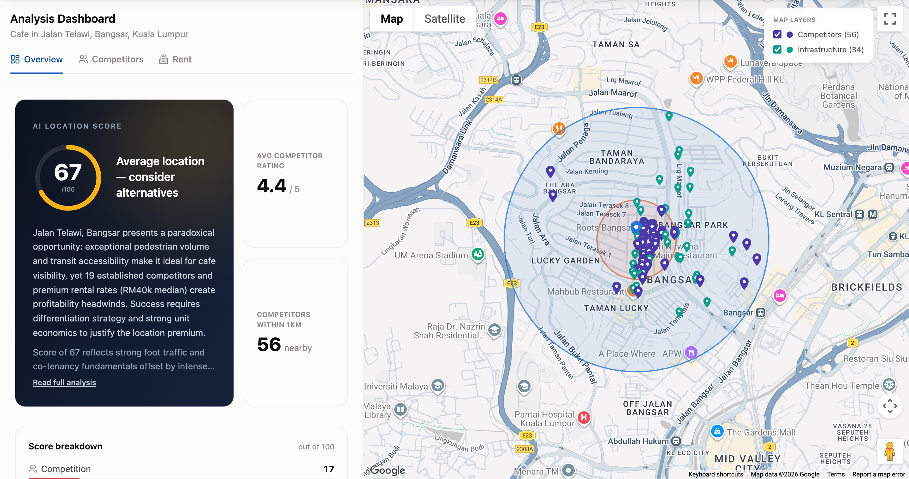
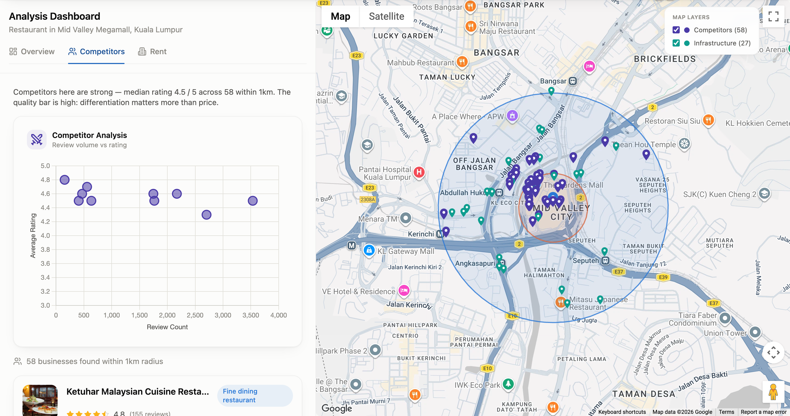
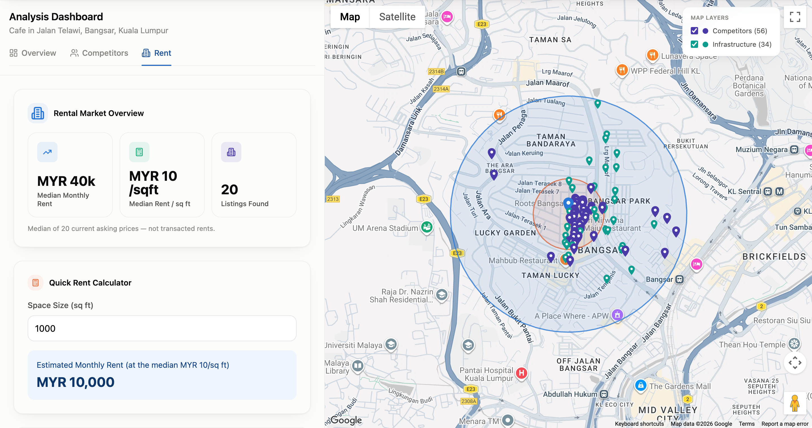

# BizLocation

A free web tool that scores how good a location is for opening a new business in Malaysia's Klang Valley.

**Try the demo:** [bizlocation-demo.netlify.app](https://bizlocation-demo.netlify.app). It runs six real saved analyses, with no sign-up.

*A real analysis of a café location on Jalan Telawi, Bangsar, Kuala Lumpur.*

I built this in my day job, so the source code is private. This page explains what it does and the product decisions behind it. I'm happy to walk through the code and the build in an interview.

## The problem

Choosing where to open a café, restaurant, gym, or shop is one of the biggest decisions a new business owner makes. Researching a spot by hand means counting nearby competitors, comparing shop rents, and judging how busy and well connected the area is. It takes time, and it is easy to miss things.

BizLocation does that research in a few minutes. You type in an address and the type of business, and it scores the location and explains the reasons behind the score.

## Who it's for

People starting or expanding a small business in Kuala Lumpur and the surrounding Klang Valley.

## How it works

1. You enter an address and a business type.
2. The app gathers nearby competitors from Google Maps, shop rental listings from PropertyGuru, and transport and building data from OpenStreetMap.
3. Claude, an AI model, reviews the data and scores the location, explaining each score in plain language.
4. You see a free preview. Leaving your email unlocks the full report, a PDF download, and an AI assistant you can ask about that location.

## Screenshots

**Competitors.** Nearby restaurants around Mid Valley Megamall on the map, with a chart of their ratings against review counts, so you can see how strong the local competition is.

**Rent.** Median asking rent and price per square foot from current shop listings near Jalan Telawi, Bangsar, with a calculator to estimate rent for your space.

## My role

I started from a rough proof of concept that was closer to an idea than a product. It didn't account for what each analysis costs to run or what the service costs to maintain, it showed sample numbers as if they were real, and it saved nothing. I rethought the idea, turned it into a free lead-generation tool, and built it out into a launched product, working on both the product decisions and the build.

## Key product decisions

**Charge contact details, not money.** The tool is free. Anyone can see a preview score, and the full report unlocks after they leave a verified email. That makes it a lead-generation tool rather than a paid product.

**Verify before spending.** Every fresh analysis costs real money for data and AI. Emails are verified before any paid analysis runs, so fake or throwaway sign-ups cost nothing.

**Cache by area.** Results are saved per neighbourhood and business type for 30 days. A popular area costs money once, and every later visitor gets it free.

**A daily budget switch.** When the day's spending hits a set limit, the site automatically serves only saved results until the next day. The limit can be changed without touching code.

**Show only real data.** I removed charts that showed sample numbers, and I labelled the scores that are estimates, such as demographics inferred from the types of nearby buildings. A business owner should never make a real decision based on a placeholder.

**Launch small.** The first version only covers Malaysian addresses, starting with the Klang Valley.

## Tech stack

- Website: React, TypeScript, Tailwind CSS, hosted on Netlify
- Server: Node.js and Express, hosted on Railway
- Database and sign-in: Supabase
- AI: Claude by Anthropic
- Data sources: Google Maps Platform, Apify (Google Maps and PropertyGuru data), OpenStreetMap, Esri satellite imagery
- CRM: HubSpot
- Quality: automated tests and checks that run on every change

## What I'd build next

- **Measure lead quality, not just lead count.** Track which leads become customers, so the budget goes to the areas and business types that bring in buyers.
- **Phone verification.** I costed three options: the visitor messages us on WhatsApp, a one-time code by SMS or WhatsApp, or staying email only. The right choice depends on how leads get followed up, so it needs that decision first.
- **Never hand out an incomplete report.** Block the PDF download when any data source failed, so a saved report never contains gaps.
- **Expand to Singapore**, once the Malaysian version proves it brings in leads.
